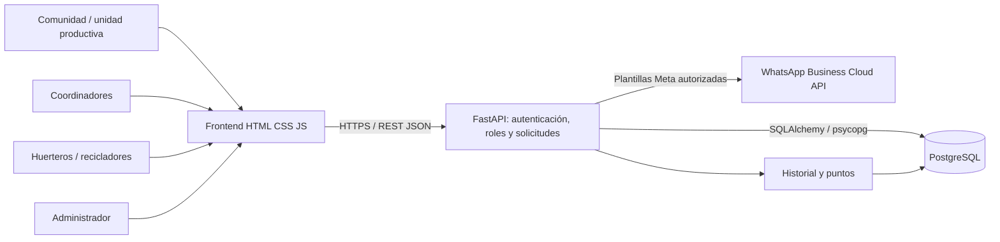
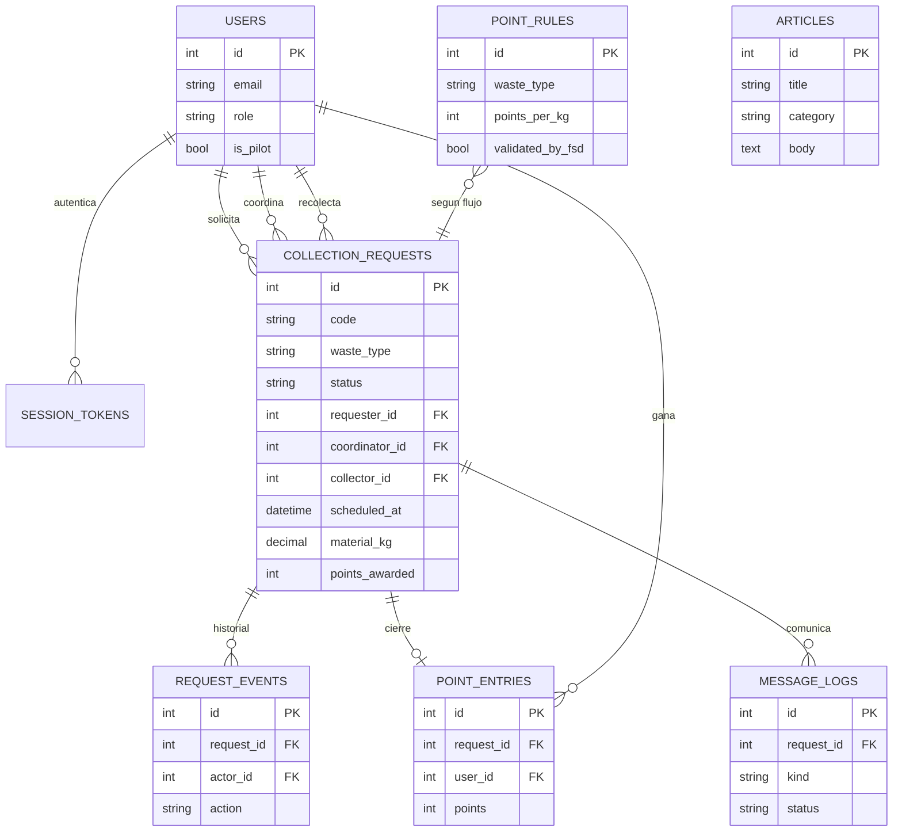

# Arquitectura técnica de EcoConecta

## Stack autorizado

- **Frontend:** HTML5, CSS3 y JavaScript (sin plataformas no-code ni librerías externas de frontend). Diseño responsive para móviles, tabletas y escritorio.
- **Backend:** Python 3.12 + FastAPI + Pydantic + SQLAlchemy.
- **Base de datos:** PostgreSQL 16, con SQLAlchemy para esquema y consultas.
- **Infraestructura:** Docker, Docker Compose y Git.
- **Notificaciones:** exclusivamente WhatsApp Business Cloud API (integración disponible mediante credenciales de Meta y plantilla aprobada).
- **IA:** no incorporada en el MVP porque no es indispensable para el flujo. En una fase posterior, utilizar únicamente uno de los proveedores autorizados.

## Componentes e interacciones

En local, Docker Compose ejecuta `web` y `db`; en producción, desplegar los dos contenedores con almacenamiento persistente para PostgreSQL. El mismo backend sirve el frontend estático, por lo que no se necesita CORS ni dominio adicional.

## Modelo de datos

Las reglas de negocio están protegidas del lado del servidor. Las solicitudes orgánicas solo pueden ser administradas por la coordinación de huerteros y asignarse a huerteros; las reciclables solo a coordinación de recicladores y recicladores. La programación requiere persona asignada, coordinador y fecha/hora futura; la recolección requiere estado `programada`; al cerrar se registra peso y un asiento único de puntos.

## Protección de datos

- Sesiones aleatorias con hash SHA-256 almacenado en la BD; contraseñas derivadas con PBKDF2-HMAC SHA-256 y sal por usuario.
- RBAC aplicado en todos los endpoints de operación; no basta con ocultar botones.
- Dirección, teléfono y observaciones no se exponen en bandejas ajenas.
- Las cuentas que se registran por sí solas tienen únicamente rol `solicitante`.
- `PILOT_ONLY=true` permite restringir nuevas solicitudes a usuarios aprobados.
- HTTPS, rotación de credenciales, respaldos, expiración de sesiones y políticas de tratamiento de datos deben configurarse antes de usar datos reales.

## Despliegue: declaración de servicios

La opción más simple es **una máquina virtual Linux en la nube** con Docker Compose:

| Componente | Servicio |
|---|---|
| Cómputo | VM Linux con Docker |
| Web / API | Contenedor Python FastAPI, puerto interno 8000 |
| Base de datos | Contenedor PostgreSQL 16 con volumen persistente |
| Almacenamiento | Volumen Docker de PostgreSQL |
| Red | Entrada HTTPS mediante proxy reverso del proveedor |
| Mensajería | Meta WhatsApp Business Cloud API |

**Pendiente de definición real:** proveedor cloud, IP, DNS, dominio HTTPS y URL pública. No se debe inventar una URL en la entrega. Para una VM, abrir únicamente 80/443 públicamente; no publicar el puerto de PostgreSQL. El ejemplo Compose abre 8000 para desarrollo: endurecer en producción mediante proxy HTTPS.
